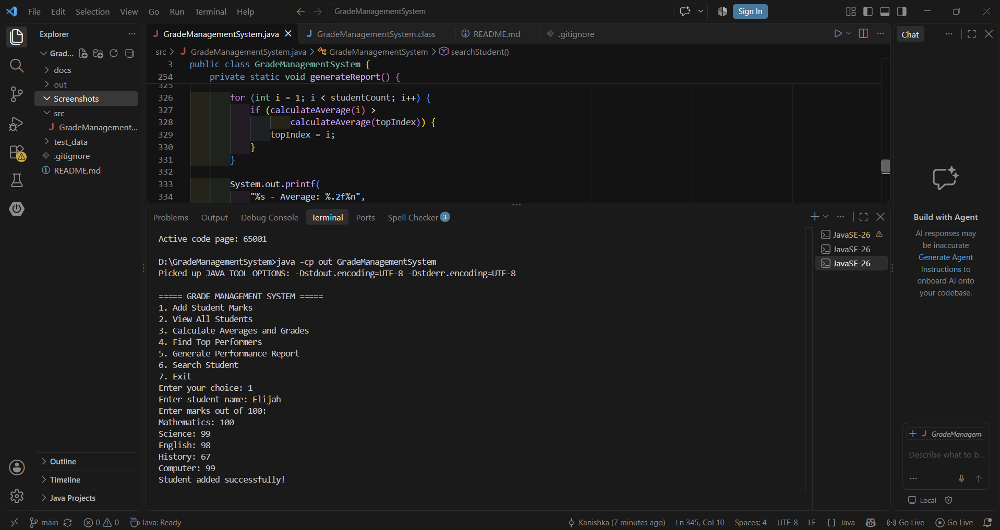
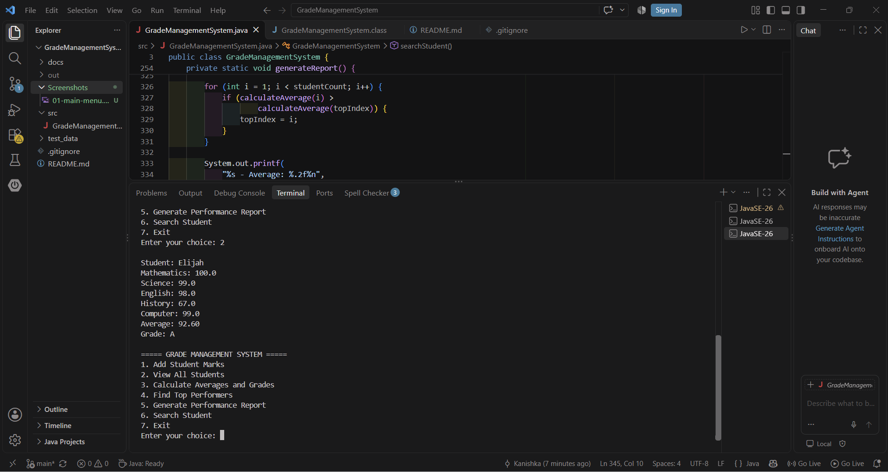
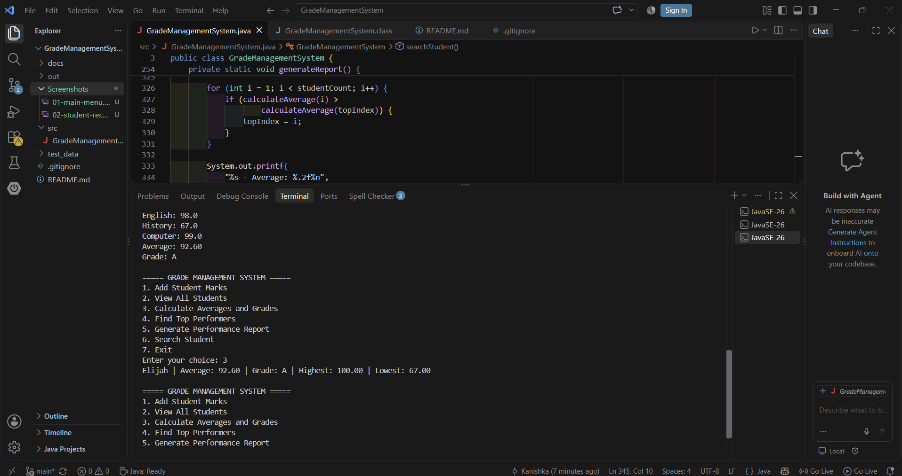
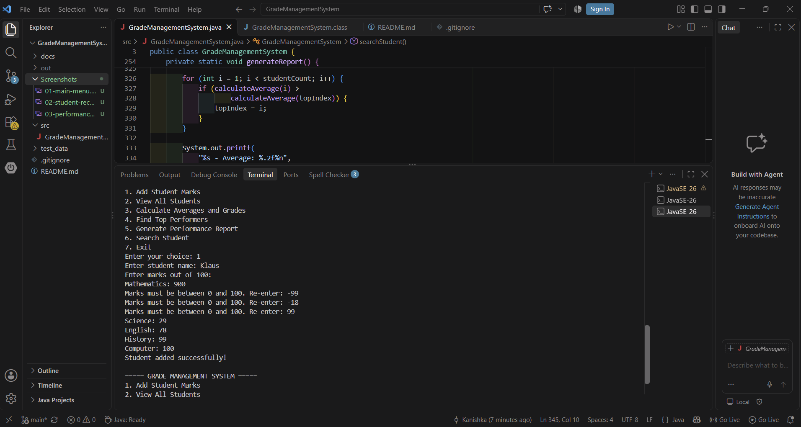

# Grade Management System

A console-based application developed using Java to manage student marks, calculate academic performance, and generate class reports.

## Features

- **Add Student Marks:** Store student names and marks for five subjects.
- **View All Students:** Display student marks, averages, and grades.
- **Calculate Averages and Grades:** Calculate individual student averages, highest marks, and lowest marks.
- **Find Top Performers:** Identify students based on their average scores.
- **Generate Performance Report:** Display class averages, subject-wise averages, and grade distribution.
- **Search Student:** Find students by name, with case-insensitive searching.
- **Input Validation:** Handle invalid inputs and ensure marks remain within the valid range of 0 to 100.

## Technologies Used

- Java
- Object-Oriented Programming fundamentals
- Arrays and multidimensional arrays
- Loops and conditional statements
- Methods and switch statements
- Exception handling
- Java Scanner for user input

## Subjects

The system manages marks for five subjects:

1. Mathematics
2. Science
3. English
4. History
5. Computer

## Grading Criteria

| Average | Grade |
|---|---|
| 90 and above | A |
| 80–89.99 | B |
| 70–79.99 | C |
| 60–69.99 | D |
| Below 60 | F |

## Project Structure
```text
GradeManagementSystem/
├── src/
│   └── GradeManagementSystem.java
├── docs/
│   ├── UserManual.md
│   └── Testing.md
├── Screenshots/
│   ├── 01-main-menu.png
│   ├── 02-student-records.png
│   ├── 03-performance-report.png
│   └── 04-input-validation.png
├── test_data/
├── .gitignore
└── README.md
```


The `out/` directory is generated during compilation and is not included in version control.

## How to Run

**Prerequisite:** Install a Java Development Kit (JDK) and ensure `java` and `javac` are available in your terminal.

1. Open a terminal in the project root directory.
2. Compile the Java source file:

   ```bash
   javac -d out src/GradeManagementSystem.java
   ```

3. Run the application:

   ```bash
   java -cp out GradeManagementSystem
   ```

4. Select an option from the menu and follow the prompts.

## Screenshots

### 1. Main Menu


### 2. Student Records


### 3. Performance Report


### 4. Input Validation



## Limitations

- Student records are stored in memory and are cleared when the program exits.
- The system supports up to 100 students per execution.
- Each student has marks for five predefined subjects.

## Future Improvements

- Store student records in a file or database.
- Add student ID support.
- Build a graphical user interface.
- Export performance reports to CSV.
- Add automated unit tests.

## Author

Kanishka M
